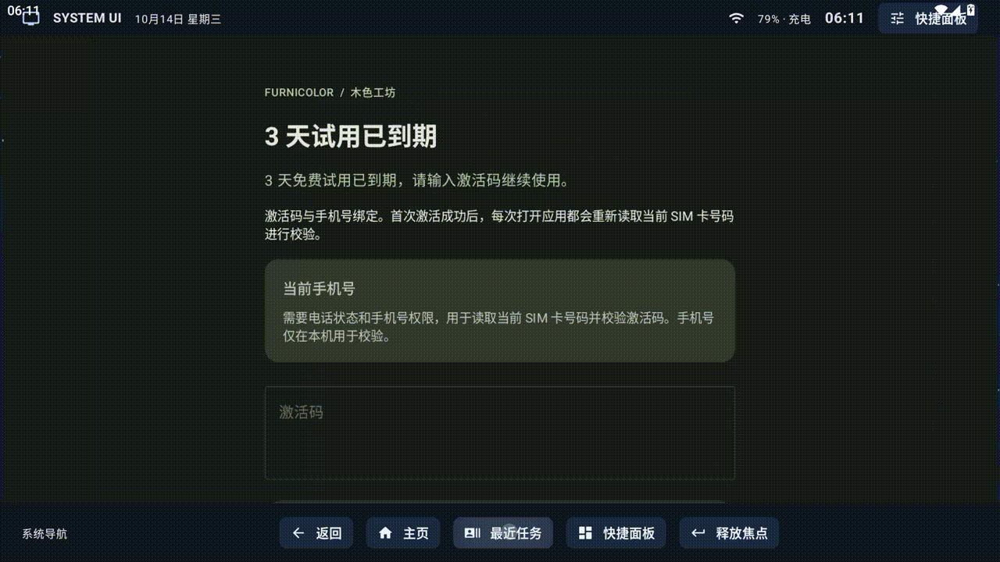

# ComposeSystemUI

Kotlin + Compose 的简单 SystemUI 窗口 demo，同一份界面支持系统应用和普通应用。
没有 Flow、Store、Reducer、Intent/Effect 分发或业务协程。按钮直接调用
`SystemUiController` 的方法，Compose 用 `mutableStateOf` 更新界面；设备状态用
`BroadcastReceiver` 和 `ContentObserver` 回调更新。系统版通过 `CommandQueue`
接收系统栏命令，再在主线程直接调用控制器。




## 两套构建

在 Android Studio 的 **Build Variants** 中选择 `demoDebug` 或 `systemDebug`。

| | 普通应用 `demo` | 系统应用 `system` |
| --- | --- | --- |
| 包名 | `com.example.simplesystemui.demo` | `com.example.simplesystemui` |
| 最低版本 | Android 8 / API 26 | Android 16 / API 36 |
| 窗口 type | 全部使用 `TYPE_APPLICATION_OVERLAY` (2038) | 状态栏 2000、导航栏 2019、通知面板 2040、左侧返回窗口 2024 |
| Manifest | `app/src/demo/AndroidManifest.xml` | `app/src/system/AndroidManifest.xml` |
| 身份 / 权限 | 普通 UID，用户授权悬浮窗 | `android.uid.system`，系统签名权限 |
| 签名 | 调试签名 | 设备平台签名；未配置时生成未签名 APK |
| Insets | 普通悬浮窗 | 状态栏、导航栏向 WMS 提供 Insets |
| 左侧返回输入 | 24dp 悬浮输入窗 | `InputMonitor` 全局触摸监视器 |

共用的应用、启动 Activity 和前台服务声明放在 `app/src/main/AndroidManifest.xml`。
构建时自动合并对应 flavor 的 Manifest，`BuildConfig.SYSTEM_UI` 自动选择代码路径，
无需手动修改窗口 type 或注释 `sharedUserId`。

```powershell
.\gradlew.bat :app:assembleDemoDebug :app:assembleSystemDebug
```

需要 JDK 17 和 Android SDK 36；Android Studio 的 Gradle JDK 也请选择 17。APK 分别输出到：

- `app/build/outputs/apk/demo/debug/app-demo-debug.apk`
- `app/build/outputs/apk/system/debug/app-system-debug-unsigned.apk`（未配置平台签名时）
- `app/build/outputs/apk/system/debug/app-system-debug.apk`（配置平台签名时）

## 普通应用演示

1. 安装 `demoDebug` APK，打开控制台。
2. 点击“授权悬浮窗”，在系统设置允许显示在其它应用上层，再返回控制台。
3. 要使用跨应用返回和最近任务，点击“启用全局导航”，在无障碍设置开启
   “Simple SystemUI 全局导航”。服务仅执行全局操作，不监听事件、不读取屏幕内容。
4. 点击“显示窗口”，可打开快捷面板、控制导航栏或关闭控制台查看跨应用显示。
5. 在控制台或服务通知点击“停止”移除全部窗口。

从本应用状态栏向下拖动可拉出快捷面板，面板展开高度跟随手指。
松手时快速下滑会展开、快速上滑会收起；慢速拖动以展开一半为界。
点击“快捷面板”仍可直接打开，点击“关闭”或按返回键关闭。
面板展开后可向上拖动收起；快速上滑直接收起，慢速拖动未过一半会恢复展开。
内容较长时，内容区先滚动，滚到底后再次上滑可收起；底部“上滑收起”区域
始终可用于收起面板。
手势从本应用状态栏开始，普通版的悬浮窗不会接管原生系统栏手势。

普通版不会替换设备系统栏，也不会改变其它应用的系统栏 Insets。
主页按钮打开桌面；返回和最近任务按钮使用全局导航服务。普通版打开设备原生最近任务。
Wi-Fi 按钮打开系统 Wi-Fi 设置，亮度调整需要“授权修改系统设置”。
部分 TV ROM 不提供悬浮窗授权入口或不允许悬浮窗，需设备本身支持。

## 左侧手势返回

从屏幕物理左边缘向右拖动，会显示跟随手指的深色气泡和白色返回箭头。
超过 56dp 松手执行一次返回，短滑、回拉、多指或手势取消均不返回。
返回触发时提供轻触反馈。手势起点限定在左侧 24dp，避开状态栏和导航栏。
快捷面板打开时先关闭面板；导航栏控制中先释放焦点；其余情况下返回前台应用。

系统版通过 `InputManager.monitorGestureInput()` 创建 `InputMonitor`，由
`InputEventReceiver` 接收默认显示器的全局触摸。按下时只观察，确认向右横滑后
调用 `pilferPointers()` 接管当前触摸，再显示返回图标；其它触摸继续由原窗口处理。
每个输入事件都调用 `finishInputEvent()`，抬手事件确认完成后才执行返回。
关闭窗口服务或重建窗口时先释放 receiver，再释放 monitor。

普通版保留原来的 24dp 输入窗和独立图标窗，不创建系统输入监视器。
普通版未开启返回服务时不会占用前台应用的边缘触摸区域；系统版沿用
`INJECT_EVENTS` 注入返回按键。普通版通过
[Android 无障碍全局操作](https://developer.android.com/reference/android/accessibilityservice/AccessibilityService#performGlobalAction(int))
执行返回，不需要读取窗口内容或注入触摸手势。

普通版建议用设备的三键导航验证。设备原生边缘返回仍开启时，系统可能接管
同一手势；收到取消事件时本应用会取消返回。Android 普通窗口的手势排除区域
[每侧最多 200dp](https://codelabs.developers.google.com/codelabs/gesture-navigation)。
系统 ROM 集成时需要统一管理原有 SystemUI 的边缘返回逻辑。

## 系统应用演示

1. 将 `platform-signing.properties.example` 复制为 `platform-signing.properties`，
   填入目标设备的平台 keystore 信息。实际签名配置已加入 `.gitignore`。
2. 选择 `systemDebug` 构建，按目标 ROM 的系统应用流程部署。
3. 确认应用获得系统 UID、`STATUS_BAR_SERVICE`、`INTERNAL_SYSTEM_WINDOW`、
   `INJECT_EVENTS`、`MONITOR_INPUT` 权限，再通过控制台启动窗口服务。

系统版不申请悬浮窗权限。系统 UID 需要与目标 ROM 匹配的平台证书，仅把 APK
放入系统目录不够。未配置密钥时可以编译，但未签名 APK 不能直接安装。
普通版始终使用调试签名，不受平台签名配置影响，两版包名不同可以共存。

原生状态栏、导航栏、通知面板在每个显示器上各只能有一个。需要在 ROM 中安排
原有 SystemUI 释放这些窗口或集成替换；现有 SystemUI 仍占用时会创建失败。
参见 [AOSP Android 16 DisplayPolicy](https://github.com/aosp-mirror/platform_frameworks_base/blob/android16-release/services/core/java/com/android/server/wm/DisplayPolicy.java)。
窗口 type 与 Insets 桥接以 Android 16 为准，厂商 ROM 的隐藏 API 可能需要适配。

`InputMonitor`、`InputChannel`、`InputEventReceiver` 不在公开 SDK 中。
`hidden-api-stubs` 模块只提供编译签名，通过 `systemCompileOnly` 引用；其类不会
打包进 APK，系统版运行时使用 ROM 的真实实现。普通版不依赖这些隐藏类型。
系统权限不足或 API 不可用时，系统版启动会报错，不切换到普通版输入窗。

## 系统栏命令

系统版启动窗口后，`CommandQueue` 向 `StatusBarManagerService.registerStatusBar()`
注册 `IStatusBar` Binder，先应用注册返回的图标、禁用标志、外观、IME 和临时栏快照，
再处理排队的实时命令。普通版的同名类为空实现，不向系统注册。

目前对接已有界面的命令包括：

- `setIcon` / `removeIcon`：按 slot 更新图标，处理可见性、资源所属用户、level 和描述。
- `disable` / `disableForAllDisplays`：控制时钟、系统图标、面板、快捷设置和导航按钮。
  禁用面板会取消拖动预览并关闭已打开的面板；控制台、手势和系统命令均遵守禁用状态。
- `onSystemBarAttributesChanged`：按屏幕坐标的 `AppearanceRegion` 更新图标明暗，
  处理透明 / 不透明背景。保存应用的显示请求，实际栏显示状态以 WMS 为准。
- `setWindowState`、`showTransient` / `abortTransient`：同步显示与临时栏状态。
  临时栏按无障碍推荐超时自动隐藏；面板打开、持有导航焦点或手指按住时暂停。
- `setImeWindowStatus`：同步收起键盘的返回图标和输入法切换入口。
- 面板展开、收起、切换，以及最近任务显示、隐藏和切换命令。

带 displayId 的命令只作用于默认显示器，与当前窗口宿主一致。Binder 线程只解码数据，
Compose 和窗口更新都在主线程执行。停止服务会清理排队任务、自动隐藏计时和控制器引用。
Android 16 的此服务接口没有 unregister 方法；下次启动重新注册。

系统栏的根窗口持续提供 Insets，隐藏时保留窗口和 frame，由 WMS 控制 surface，避免
沉浸模式恢复及忽略可见性的 Insets 查询出错。接口参数按
[Android 16 IStatusBar](https://github.com/aosp-mirror/platform_frameworks_base/blob/android16-release/core/java/com/android/internal/statusbar/IStatusBar.aidl)
核对；transaction ID 和 Parcelable Creator 从运行 ROM 读取。厂商修改参数布局时仍需适配。
生物识别、锁屏、电源菜单、Toast 等其它 `IStatusBar` 职责尚未实现，本项目仍是系统栏演示。

## 通知

两版共用 `SimpleNotificationListener`、`NotificationRepository` 和 Compose 通知卡片。
收到通知先写入按 key 保存的列表；同 key 更新原卡片；系统移除后删除卡片。
列表按发布时间倒序显示应用、标题、正文和时间，状态栏显示通知数量。
通知在现有快捷面板下方显示，快捷设置被禁用时仍可查看通知。

- 普通版：在控制台点击“开启通知使用权”，由用户在系统设置中允许
  “Simple SystemUI 通知”。Android 随后绑定监听服务；未授权时显示设置入口。
  通知使用权与悬浮窗权限、`POST_NOTIFICATIONS` 发通知权限是不同的权限。
- 系统版：窗口服务启动时，用系统权限直接注册同一个监听器，停止时注销。
  注册和注销的隐藏接口按 Android 16 对接，系统版需要平台签名、系统 UID 和
  `STATUS_BAR_SERVICE`；无需去设置中手动授予通知使用权。
  显式过滤当前用户，切换用户后清空旧列表并重新注册。

点击有打开动作的卡片，先关闭面板、释放按键焦点，再发送通知原有的 `PendingIntent`。
配置为点击后自动取消的通知，会请求系统清除；失效的动作会显示提示。
可清除通知支持“清除”、横向滑动和“全部清除”；不可清除的通知保留。
清除请求等待系统回调确认，关闭面板不会清空通知。

这是一份平铺列表，不实现通知分组、重要性排名、顶部横幅、直接回复或自定义
`RemoteViews`。分组摘要和本应用的窗口服务通知不进入列表，子通知正常显示。
不重复播放提示音或振动，由设备原有通知服务处理。锁屏或熄屏时隐藏通知内容并
阻止打开、清除操作，解锁后恢复；不实现锁屏通知界面。
普通版能读取的范围受系统通知使用权和隐私策略限制。

## 最近任务

系统版点击导航栏或控制台的“最近任务”，在现有面板窗口显示任务卡片，与快捷面板互斥。
卡片显示应用名称、图标和系统保存的画面；没有可用截图时显示“暂无预览”。
点击卡片切回原任务，上滑超过 72dp 或点击“移除”删除该任务；支持方向键选择、
确认打开，以及返回/关闭面板。刷新按钮重新读取任务列表。

任务列表、图标、截图加载以及切换/移除请求在单独的工作线程执行，结果回到主线程更新
Compose。关闭面板会清空预览并忽略旧请求结果；停止服务会关闭工作线程。
切回任务前先隐藏面板、释放按键焦点。列表不显示桌面、最近任务界面及本应用控制台。

系统版通过 Android 16 的 ActivityTaskManager 隐藏接口读取、恢复、移除任务，
需要平台签名、系统 UID 及 system Manifest 中声明的任务管理和截图权限。
接口以 [Android 16 AOSP 任务服务](https://github.com/aosp-mirror/platform_frameworks_base/blob/android16-release/services/core/java/com/android/server/wm/ActivityTaskManagerService.java) 为准。
普通版不读取其它应用任务，不调用这些隐藏接口；启用全局导航服务后打开设备的
原生最近任务，由设备系统负责卡片、切换和移除。

## 主要代码

- `MainActivity.kt`：启动/停止服务和权限入口。
- `SystemUIService.kt`：前台通知、窗口与回调的创建/清理。
- `SystemUiController.kt`：按钮直接调用的简单方法和 Compose 状态。
- `data/DeviceRepository.kt`：时间、电量、Wi-Fi、亮度的系统回调。
- `data/RecentTasksRepository.kt`：最近任务列表、图标、截图与系统任务操作。
- `data/NotificationRepository.kt`：共用通知列表、更新、清除与锁屏内容保护。
- `data/SimpleNotificationListener.kt`：共用通知监听、初始恢复和连接生命周期。
- `ui/NotificationsSection.kt`：通知卡片、点击、清除、横滑及连接/空列表状态。
- `src/demo/.../platform/NotificationAccess.kt`：普通版通知使用权检查及重连请求。
- `src/system/.../platform/NotificationAccess.kt`：系统监听注册、用户隔离和注销。
- `ui/RecentsPanel.kt`：最近任务卡片、上滑移除、遥控器操作及加载/错误状态。
- `window/SystemWindowHost.kt`：`addView`、显示/隐藏面板、切换按键焦点。
- `window/VerticalSwipeHandler.kt`：状态栏下拉、面板上滑识别、滑动距离与松手速度。
- `window/EdgeBackWindow.kt`：按构建版本选择输入来源，并管理返回图标窗口。
- `window/EdgeBackGesture.kt`：共用的左侧返回手势识别、距离判断和取消逻辑。
- `src/system/.../window/SystemGestureInput.kt`：系统全局监听、触摸接管和输入资源释放。
- `src/demo/.../window/SystemGestureInput.kt`：普通版占位实现，防止误调用系统输入监听。
- `window/EdgeBackIndicatorView.kt`：跟随手指的返回气泡与箭头。
- `platform/BackAccessibilityService.kt`：普通版的全局返回和原生最近任务接口。
- `platform/SystemWindowTypes.kt`：两种窗口 type。
- `platform/PlatformWindowApi.kt`：系统版 Insets 隐藏 API 桥接。
- `src/system/.../platform/CommandQueue.kt`：系统栏 Binder 注册、初始快照、主线程分发和临时栏自动隐藏。
- `platform/SystemBarState.kt`：系统栏禁用、外观、显示和输入法状态。
- `ui/SystemStatusIcons.kt`：系统 slot 图标加载与显示。

窗口默认不抢按键。点击“控制导航栏”后可以用方向键操作；返回或“释放焦点”
把按键交还前台应用。导航操作会等待窗口释放焦点后执行。

本次构建与验证结果见 `BUILD_VALIDATION.md`。
