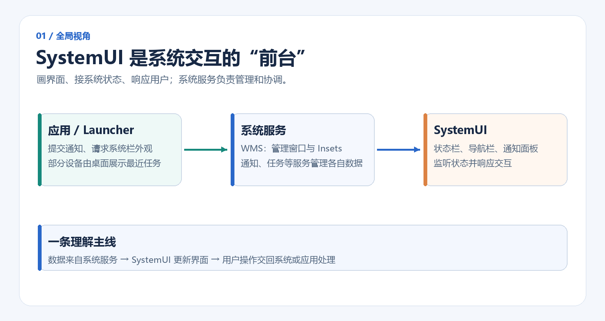
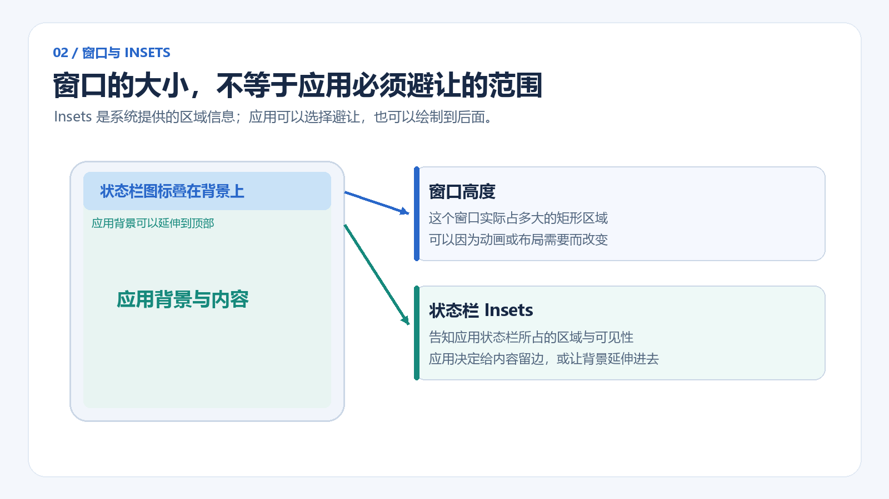
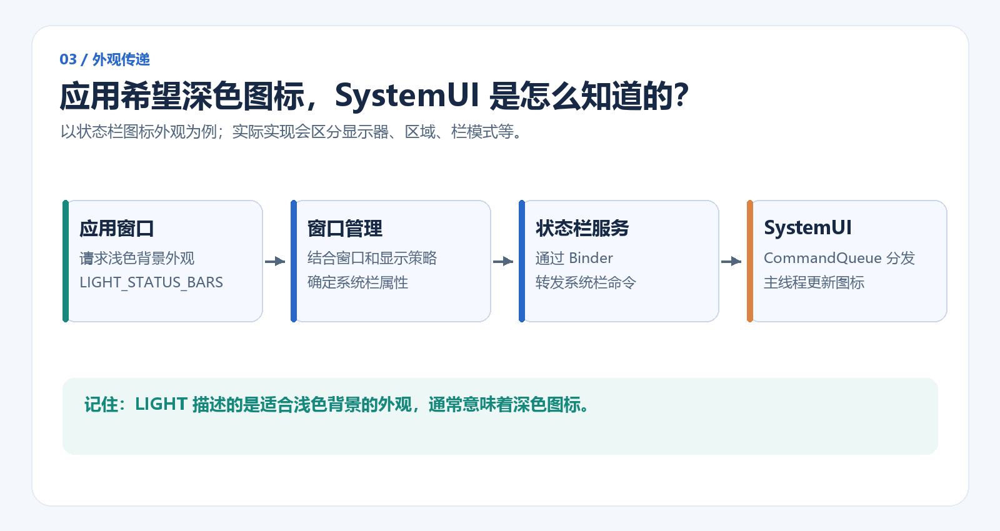
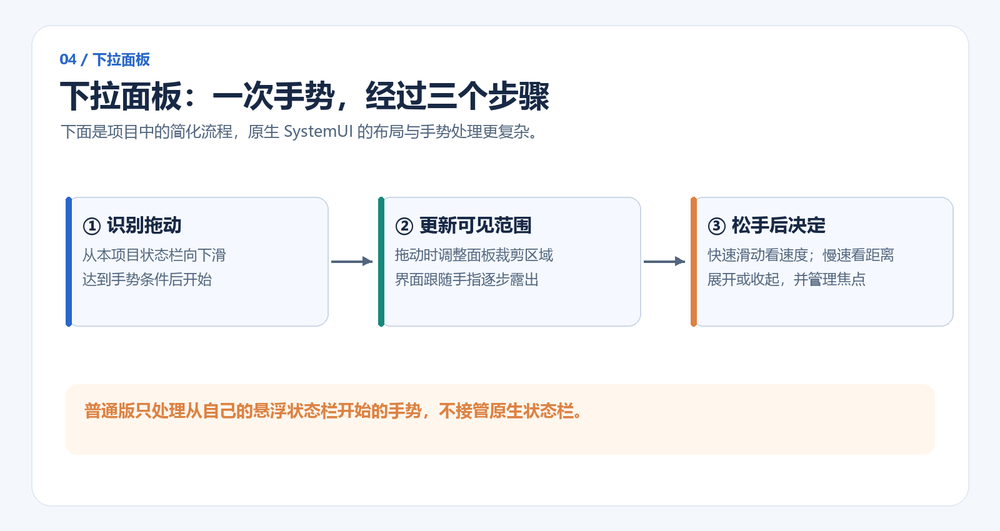
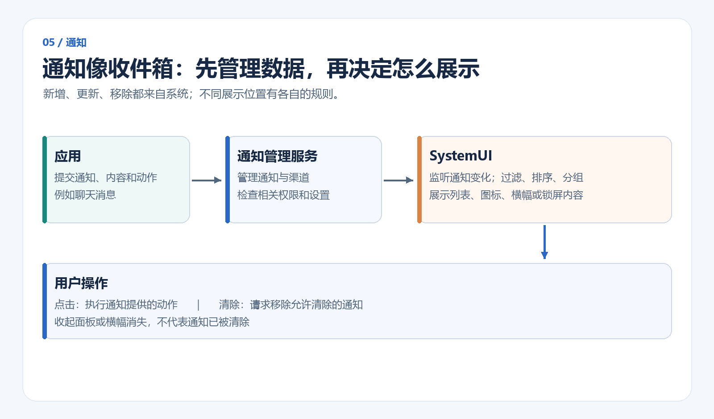
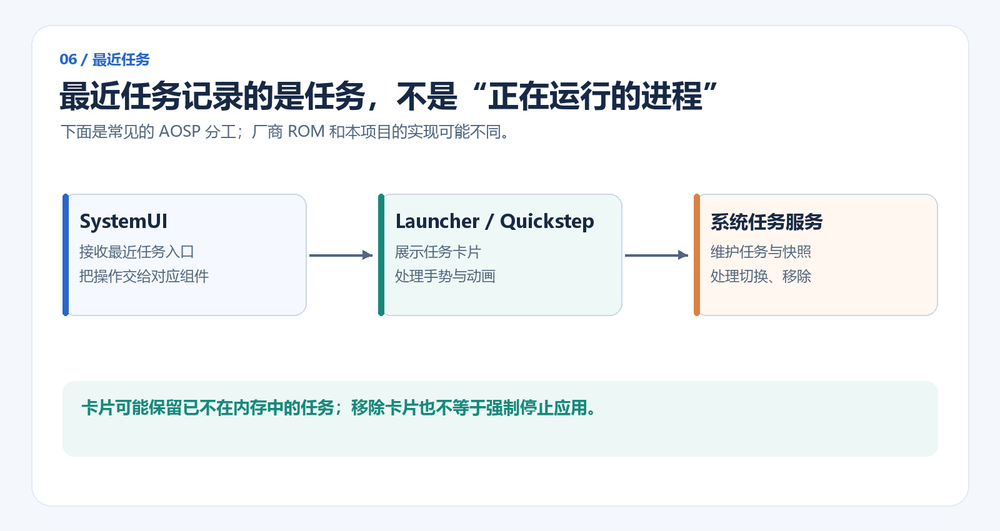

# 用大白话理解 Android SystemUI：从状态栏到通知、最近任务（附 Compose + Kotlin Demo）

每天打开手机，我们都会看到时间、电量、导航栏，也会下拉快捷面板、查看通知、切换最近任务。这些界面大多不属于当前打开的 App，却一直陪着我们使用设备。

它们是怎么显示出来的？App 的页面变成白色时，状态栏图标为什么也会跟着变深？下拉面板收起来后，通知为什么还在？

这篇文章不打算从几百个类开始讲，而是先用一条主线把这些问题串起来：**系统服务管理状态，SystemUI 把状态展示出来，并接收用户操作。**

> 本文以 AOSP 的常见实现为参考，并结合 [ComposeSystemUI 示例项目](https://github.com/FrozenFreeFall/ComposeSystemUI)说明。系统内部接口会随 Android 版本和厂商 ROM 改变；涉及系统窗口与隐藏接口的代码用于解释原理，不代表普通 App 可以直接使用。

## 一、SystemUI 到底是什么？

可以把 Android 想象成一家餐厅：

- **系统服务**像后厨和管理系统，负责维护窗口、通知、任务等状态。
- **SystemUI**像服务台，把状态展示给用户，也接收点击、滑动等操作。
- **普通 App**负责自己的业务，例如聊天、音乐和地图。



你看到的状态栏、导航栏、通知面板和快捷设置，通常都与 SystemUI 有关。但别把所有界面都归到一个进程里：例如在常见的 AOSP 实现中，最近任务卡片通常由 Launcher 的 Quickstep 部分负责，具体分工还会因设备而异。

SystemUI 本身也是 Android 应用，但它通常作为系统镜像的一部分运行，能与系统服务使用特权接口。**把一个普通 APK 命名为 SystemUI，或只写上 `sharedUserId`，并不会自动获得这些能力。**权限、签名、系统部署方式以及 ROM 的实现都要匹配。`sharedUserId` 本身已被弃用，不适合普通新应用依赖；本文项目的系统版使用它是特定平台演示的选择。参见 [Manifest 的 sharedUserId 文档](https://developer.android.com/guide/topics/manifest/manifest-element#uid)。

接下来先从最容易观察到的状态栏开始。

## 二、状态栏是怎么出现在屏幕上的？

从窗口的角度看，状态栏首先是一块由窗口管理系统管理的区域。SystemUI 创建界面，再把界面交给 `WindowManager`；窗口管理系统（下文简称 **WMS**）负责检查、布局和管理窗口。

把关键动作抽出来，思路大致是这样：

```kotlin
// 原理示意：TYPE_STATUS_BAR 及其使用需要系统环境，普通 App 不能直接照搬。
val statusBarView = TextView(context).apply {
    text = "12:00  Wi-Fi  100%"
    setTextColor(Color.WHITE)
    setBackgroundColor(Color.TRANSPARENT)
    gravity = Gravity.CENTER_VERTICAL
}

val params = WindowManager.LayoutParams(
    WindowManager.LayoutParams.MATCH_PARENT,
    statusBarHeightPx,
    /* TYPE_STATUS_BAR：系统状态栏窗口类型 */ 2000,
    WindowManager.LayoutParams.FLAG_NOT_FOCUSABLE,
    PixelFormat.TRANSLUCENT
).apply {
    gravity = Gravity.TOP
}

val windowManager = context.getSystemService(WindowManager::class.java)
windowManager.addView(statusBarView, params)
```

这一段只帮助我们看清「创建界面 → 描述窗口 → 添加窗口」的骨架。它省略了系统权限、窗口上下文、Insets、生命周期、适配和错误处理，也不构成一个可直接替换系统状态栏的完整实现。

示例项目的 [`SystemWindowHost.kt`](https://github.com/FrozenFreeFall/ComposeSystemUI/blob/main/app/src/main/java/com/example/simplesystemui/window/SystemWindowHost.kt) 用 `FrameLayout` 承载 `ComposeView`，再通过 `WindowManager.addView()` 添加窗口；界面使用 Compose 编写。两种构建版本使用不同的窗口类型：

| 项目版本 | 窗口方式 | 用途与边界 |
| --- | --- | --- |
| `demo` 普通版 | `TYPE_APPLICATION_OVERLAY` 悬浮窗 | 需要用户授权；用于学习和演示，不替换设备原生系统栏 |
| `system` 系统版 | 使用状态栏、导航栏等系统窗口类型 | 面向 Android 16 系统环境，需要匹配的权限、平台签名和 ROM 集成 |

普通悬浮窗一般位于应用窗口之上，但仍受系统管理，不能等同于真正的状态栏窗口。窗口类型和悬浮窗权限可参考 [WindowManager.LayoutParams](https://developer.android.com/reference/android/view/WindowManager.LayoutParams)。

## 三、窗口有高度，为什么还需要 Insets？

假设状态栏窗口高 40 像素。WMS 知道这个窗口的大小，但应用还需要知道：屏幕顶部哪里可能被系统栏占用？按钮和文字是否需要避开？

这就要用到 **WindowInsets**。可以把它理解成系统发给应用的一份「屏幕边缘区域说明书」，其中包含状态栏、导航栏等区域的信息。应用可以据此给重要内容留出空间，也可以让背景延伸到系统栏后面。



| 概念 | 回答的问题 |
| --- | --- |
| 窗口高度 | SystemUI 的这个窗口有多高？ |
| 状态栏 Insets | 对应用而言，状态栏对应的顶部区域是什么？ |

两者经常相近，但不是同一个概念。例如，某个系统实现可能为了动画让窗口临时变大，而提供给应用的状态栏区域仍然只是顶部的一小条。**应用是否避让以及避让多少，还取决于它如何处理 Insets。**

在系统侧，状态栏窗口可以提供状态栏 Insets 来源。WMS 处理窗口时，将相应信息纳入窗口布局和 Insets 管理。本文项目的 Android 16 系统版在 [`PlatformWindowApi.kt`](https://github.com/FrozenFreeFall/ComposeSystemUI/blob/main/app/src/main/java/com/example/simplesystemui/platform/PlatformWindowApi.kt) 中桥接相关隐藏接口；这不是普通 SDK 的通用用法。

> Insets 不只是一个固定高度：不同系统区域有不同类型，还存在可见性、显示区域、手势和键盘等因素。阅读应用侧处理方式可从 [Android 的窗口 Insets 文档](https://developer.android.com/develop/ui/compose/system/insets)开始。

## 四、状态栏的背景和图标颜色是谁决定的？

这里把两件事分开理解会轻松很多：**图标显示在状态栏这一层，背景可能来自图标后面的应用内容。**系统在某些场景下也会绘制保护层或自己的背景，实际效果取决于版本、窗口和设备。

### 1. 背景：从「设置颜色」到「画到系统栏后面」

旧版本中，应用常用 `window.statusBarColor` 设置状态栏区域颜色。但在 Android 15 及以上设备上，当应用 target SDK 达到 35 或更高时，系统默认采用边到边布局，状态栏透明，`setStatusBarColor` 不再按过去的方式生效。此时需要让应用自己的背景延伸到状态栏后面，同时处理好文字、按钮等内容的 Insets。

这不是说所有旧设备和所有 target SDK 的表现都一样；完整条件和例外请看 [Android 15 行为变更](https://developer.android.com/about/versions/15/behavior-changes-15#edge-to-edge)。

### 2. 图标：应用表达希望，系统协调后通知 SystemUI

白色背景配白色图标会看不清，因此应用可以请求适合浅色背景的状态栏外观。在 Android 11 / API 30 及以上，可以这样表达：

```kotlin
// Activity 中，API 30+。
val lightBackground = WindowInsetsController.APPEARANCE_LIGHT_STATUS_BARS

// 请求适合浅色背景的状态栏外观：通常表现为深色图标。
window.insetsController?.setSystemBarsAppearance(lightBackground, lightBackground)

// 清除这个请求：通常切回适合深色背景的浅色图标。
window.insetsController?.setSystemBarsAppearance(0, lightBackground)
```

这里的 `LIGHT` 描述的是**浅色背景的外观**，不是「图标一定是浅色」。兼容更早版本时，可以考虑 AndroidX 的 `WindowInsetsControllerCompat`。



把内部流程简化后，可以这样理解：

1. 应用窗口提出外观请求。
2. WMS 根据当前窗口、显示器和系统策略确定系统栏属性。
3. 状态栏服务通过 Binder 把变化转给 SystemUI。
4. SystemUI 的 `CommandQueue` 接收并分发，界面层更新图标。

**Binder 可以理解为不同进程之间传递调用的一座桥。**`system_server` 中的服务与 SystemUI 通常不在同一个进程，因此需要通过它通信。注册时系统还会返回初始状态；后续变化再通过回调送达，不能只等下一次变化才初始化界面。

下面是逻辑示意，并非 AOSP 方法的完整签名：

```kotlin
// 伪代码：系统侧向已注册的 SystemUI 转发属性变化。
statusBarCallback?.onSystemBarAttributesChanged(appearance)

// 伪代码：SystemUI 接收后切到主线程，再通知界面组件。
mainHandler.post {
    updateStatusBarAppearance(appearance)
}
```

实际实现会处理显示器、不同区域的外观、系统栏模式等信息，不只是一个布尔值。项目系统版的 [`CommandQueue.kt`](https://github.com/FrozenFreeFall/ComposeSystemUI/blob/main/app/src/system/java/com/example/simplesystemui/platform/CommandQueue.kt) 也按系统版流程注册、应用初始状态并分发命令；普通版不注册系统状态栏服务。

### 3. 显示与隐藏：应用发起的是请求

以 API 30+ 为例：

```kotlin
window.insetsController?.hide(WindowInsets.Type.statusBars())
window.insetsController?.show(WindowInsets.Type.statusBars())
```

应用通过 Insets 控制接口请求显隐，由系统协调窗口和系统栏。不要把它理解成应用直接拿到 SystemUI 的 View，然后调用 `GONE`。沉浸模式、临时显示和系统策略都会影响最终结果。参见 [沉浸式模式文档](https://developer.android.com/develop/ui/views/layout/immersive)。

## 五、下拉快捷面板是怎么跟手指移动的？

我们从使用者的角度拆解一次下拉：

1. 手指按在状态栏附近并向下移动，系统识别这是一次下拉手势。
2. 面板随着手指露出；松手前，界面持续更新。
3. 松手后，根据滑动速度、距离等条件，决定展开还是收起。
4. 面板打开后，需要处理触摸、返回键、焦点和内容滚动。



示例项目使用 [`VerticalSwipeHandler.kt`](https://github.com/FrozenFreeFall/ComposeSystemUI/blob/main/app/src/main/java/com/example/simplesystemui/window/VerticalSwipeHandler.kt) 识别手势；`SystemWindowHost` 根据拖动距离调整面板的裁剪区域。松手时，快速滑动优先看速度，慢速滑动则参考是否超过展开高度的一半，再通过动画到达目标状态。

这只是可读性优先的演示，原生实现还要处理更多触摸冲突、动画和状态。项目**普通版的手势从本项目的悬浮状态栏开始**，不会接管设备原有状态栏。窗口默认也不抢按键焦点；面板等需要交互的界面打开时，再按项目逻辑调整焦点。

快捷设置里的 Wi-Fi、亮度等也不是「画个按钮就能控制」：还要读取真实状态、调用对应能力并处理权限。例如本项目普通版的 Wi-Fi 按钮打开系统设置，亮度调整需要用户授予修改系统设置的权限。

## 六、通知模块：把它想成一个收件箱

假设聊天 App 收到一条新消息：

1. App 向系统提交通知，包含标题、正文、图标和可选动作。
2. **NotificationManagerService** 管理通知，并结合权限、渠道和用户设置处理。
3. SystemUI 监听通知变化，维护并整理要展示的内容。
4. 用户点击、回复或清除时，SystemUI 再把相应操作交给系统或通知提供的动作。



### 通知有新增，也有更新和移除

下载进度从 20% 变成 50% 时，通常是同一条通知更新，而不是不断添加新卡片。通知可能由应用主动取消，也可能由用户清除。SystemUI 需要同步这些变化；监听器连接后还需要恢复当前仍有效的通知。

原生 SystemUI 不只是把列表按时间排一下，还要考虑用户、锁屏隐私、分组、排序、重要程度等规则。因此，系统保存着一条通知，不代表它一定会在每个位置显示完整内容。

### 一条通知可以有不同展示方式

| 位置 | 常见表现 |
| --- | --- |
| 状态栏 | 小图标，提醒有通知 |
| 下拉通知面板 | 内容卡片及可用操作 |
| 屏幕顶部 | 符合规则时短暂弹出的 Heads-up 横幅 |
| 锁屏 | 按设备和隐私设置显示内容、隐藏正文或不显示 |

横幅消失，只说明这次短暂展示结束；通知通常仍然可能留在列表里。收起面板同样不会自动清空通知。

### 点击和清除分别意味着什么？

- **点击通知**：通常执行应用预先提供的 `PendingIntent`，例如打开聊天；是否自动清除取决于通知配置和后续处理。
- **清除通知**：对允许清除的通知向系统发出移除请求，不会删除聊天记录等业务数据。
- **清除全部**：只清除符合条件的通知，某些不可清除的通知仍会保留。
- **回复等动作**：界面收集用户输入后，将动作交给应用处理。

[Android 通知概述](https://developer.android.com/develop/ui/compose/notifications)和 [`NotificationListenerService`](https://developer.android.com/reference/android/service/notification/NotificationListenerService) 介绍了应用侧和监听侧的公开能力。

### 示例项目实现了哪些？

项目通过 `SimpleNotificationListener` 和 `NotificationRepository` 维护通知列表，同 key 更新原卡片，移除回调到来后删除。普通版需要用户在设置中开启通知使用权；系统版通过平台权限注册监听。两者都不是 `POST_NOTIFICATIONS` 发通知权限的同义词。

项目目前提供基础的通知卡片、点击和清除，并在锁屏或熄屏时保护内容；**没有实现完整的通知分组、排序、Heads-up、直接回复或自定义 RemoteViews**。这些限制有助于把演示和原生完整能力区分开。

## 七、最近任务：卡片不是进程列表

打开最近任务时，屏幕上看到的是一个个**任务**的卡片。任务可以理解为用户完成某件事时的一组 Activity 和导航历史；它与 Linux 进程不是一一对应的关系。

因此，有两点很容易误解：

- 某张任务卡片仍然存在，并不证明对应进程此刻还在内存中。系统可以保留任务记录和快照，在用户回来时重新创建界面。
- 从最近任务里移除卡片，也不能简单等同于对整个应用执行「强制停止」。



在常见的 AOSP 分工中，SystemUI 处理最近任务入口，Launcher3 的 Quickstep 负责卡片和交互动画，系统任务服务维护任务并处理切换、移除等请求。厂商 ROM 可能调整这条链路。可参考 [Launcher3 的 RecentsView](https://android.googlesource.com/platform/packages/apps/Launcher3/+/refs/heads/main/quickstep/src/com/android/quickstep/views/RecentsView.java) 和 [任务与返回栈文档](https://developer.android.com/guide/components/activities/tasks-and-back-stack)。

用伪代码理解卡片界面即可：

```kotlin
// 伪代码：systemTasks 代表具备相应系统权限的任务接口。
val tasks = systemTasks.getRecentTasks()

tasks.forEach { task ->
    TaskCard(
        title = task.title,
        image = task.snapshot,
        onClick = { systemTasks.open(task.id) },
        onSwipeUp = { systemTasks.remove(task.id) }
    )
}
```

普通应用不能把这段当成跨应用获取完整任务列表的公开 API。项目普通版通过无障碍全局操作打开设备原生的最近任务；系统版则在自己的面板展示任务卡片，并使用 Android 16 系统隐藏接口执行任务操作。二者的权限与行为不同。

## 八、动手运行 ComposeSystemUI

项目提供两个构建版本，建议先用普通版理解窗口、面板和数据流，再在可控的系统镜像中研究系统版。

### 先运行普通版

1. 使用 JDK 17、Android SDK 36，在 Android Studio 选择 `demoDebug`，或在项目根目录执行：

   ```powershell
   .\gradlew.bat :app:assembleDemoDebug
   ```

2. 安装 `app/build/outputs/apk/demo/debug/app-demo-debug.apk`，打开控制台并按提示授予悬浮窗权限。
3. 点击「显示窗口」后，从项目自己的状态栏下拉，体验面板。
4. 如果需要项目的跨应用返回和原生最近任务入口，按控制台提示启用其无障碍服务；查看通知则单独启用通知使用权。
5. 在控制台或服务通知中停止窗口服务。

普通版的可用性受设备和 ROM 限制：它不会替换系统栏，也不会改变其他应用的系统栏 Insets。原生边缘返回与演示手势可能发生竞争。

### 再了解系统版

`systemDebug` 面向项目适配的 Android 16 系统环境。它需要目标设备的平台签名、对应系统身份和权限，并按目标 ROM 的方式部署；未配置签名时可以生成未签名 APK，但不能直接安装使用。

系统栏窗口可能已被原有 SystemUI 占用，不能指望两个实现随意同时接管。真实集成需要安排原实现释放或迁移对应能力，还要处理厂商隐藏接口差异。构建、权限与操作步骤以项目 [README](https://github.com/FrozenFreeFall/ComposeSystemUI#readme) 为准。

如果想顺着代码阅读，可以从这几处入手：

| 想看什么 | 项目文件 |
| --- | --- |
| 服务如何启动和清理 | `SystemUIService.kt` |
| 状态如何传到 Compose | `SystemUiController.kt`、`data/DeviceRepository.kt` |
| 窗口如何创建、面板如何展示 | `window/SystemWindowHost.kt`、`window/VerticalSwipeHandler.kt` |
| 系统栏命令如何接入 | `src/system/.../platform/CommandQueue.kt` |
| 通知如何监听和维护 | `data/SimpleNotificationListener.kt`、`data/NotificationRepository.kt` |
| 最近任务如何展示 | `data/RecentTasksRepository.kt`、`ui/RecentsPanel.kt` |

## 九、定制设备能不能重写 SystemUI？

车载、电视、投影或掌机等设备的交互方式和手机不同，围绕自己的业务定制系统界面是合理的。对于范围明确的设备，也可以设计自己的系统栏和面板实现。

但「做出一条状态栏」与「完整替换原生 SystemUI」之间还有很大距离。锁屏、系统安全提示、通知隐私、无障碍、多用户、多显示器、输入法、手势冲突以及设备特有功能，都可能依赖原有实现。是否替换、保留还是逐步迁移，要先盘点目标 ROM 的职责和依赖，再在可恢复的设备环境中验证。

理解时抓住三句话就够了：**窗口负责承载界面，系统服务负责管理状态，SystemUI 把两者连接到用户操作。**先把一条链路走通，再逐步补齐权限、交互和设备场景，源码就不会显得那么难读了。

## 延伸阅读

- [原文：用大白话了解 SystemUI 的原理](https://juejin.cn/post/7695677977552273417)
- [ComposeSystemUI 示例项目与运行说明](https://github.com/FrozenFreeFall/ComposeSystemUI)
- [AOSP Android 16：DisplayPolicy](https://github.com/aosp-mirror/platform_frameworks_base/blob/android16-release/services/core/java/com/android/server/wm/DisplayPolicy.java)
- [AOSP Android 16：StatusBarManagerService](https://github.com/aosp-mirror/platform_frameworks_base/blob/android16-release/services/core/java/com/android/server/statusbar/StatusBarManagerService.java)
- [AOSP Android 16：CommandQueue](https://github.com/aosp-mirror/platform_frameworks_base/blob/android16-release/packages/SystemUI/src/com/android/systemui/statusbar/CommandQueue.java)
- [Android：边到边布局](https://developer.android.com/develop/ui/views/layout/edge-to-edge)
